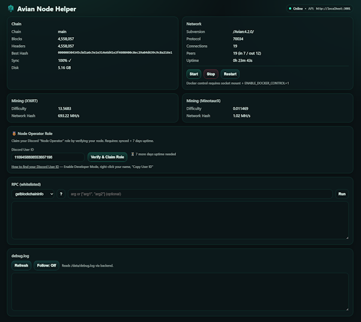

# Radiant Node Helper

A simple web UI for running and monitoring a **Radiant blockchain node** using Docker.

**Discord:** https://discord.gg/radiantblockchain



## Features

- 🟢 **Live node status** — chain info, peers, mempool, uptime
- ⛏️ **Mining info** — SHA512/256 hashrate and difficulty
- 🔧 **RPC commands** — run whitelisted commands from the UI
- 🐳 **Docker control** — start/stop/restart the node (optional)
- 📜 **Debug log viewer** — tail the node's log in real-time (optional)
- 🎖️ **Discord roles** — claim "Node Operator" (7d) and "Elite Node Operator" (90d) roles

---

## Requirements

- **Docker** and **Docker Compose**
  - Windows/macOS: Install [Docker Desktop](https://www.docker.com/products/docker-desktop/)
  - Linux: Install [Docker Engine](https://docs.docker.com/engine/install/)

---

## Quick Start

### 1. Configure

Copy the example environment file:

```bash
# Linux / macOS / Git Bash
cp .env.example .env

# Windows PowerShell
Copy-Item .env.example .env

# Windows CMD
copy .env.example .env
```

Edit `.env` and change the RPC password:

```env
RADIANT_RPC_PASS=your_secure_password_here
```

### 2. Start

```bash
docker compose up --build -d
```

> First build downloads Radiant Core v2.1.0 from GitHub releases (~1-2 min).

### 3. Open the UI

- **UI:** http://localhost:3000
- **API:** http://localhost:3001/status

That's it! 🎉

---

## Configuration Options

Edit `.env` to customize:

| Variable                  | Default       | Description                                              |
| ------------------------- | ------------- | -------------------------------------------------------- |
| `RADIANT_RPC_USER`        | `radiantrpc`  | RPC username                                             |
| `RADIANT_RPC_PASS`        | `change_me`   | RPC password (**change this!**)                          |
| `RADIANT_UPNP`            | `0`           | Set to `1` for automatic port forwarding (inbound peers) |
| `RADIANT_DISABLE_WALLET`  | `1`           | Set to `0` to enable wallet RPC commands                 |
| `ENABLE_DOCKER_CONTROL`   | `0`           | Set to `1` to enable start/stop/restart buttons          |
| `ENABLE_LOG_VIEW`         | `0`           | Set to `1` to enable debug log viewer                    |

---

## Optional: Enable Docker Control

To start/stop/restart the node from the UI:

1. In `.env`, set:

   ```env
   ENABLE_DOCKER_CONTROL=1
   ```

2. The Docker socket mount is already configured in `docker-compose.yml`

3. Restart:
   ```bash
   docker compose up -d
   ```

---

## Ports

| Port | Service                        |
| ---- | ------------------------------ |
| 3000 | Web UI                         |
| 3001 | Backend API                    |
| 7333 | Radiant P2P (blockchain sync)  |
| 7332 | Radiant RPC (internal only)    |

---

## Updating

Pull latest code and rebuild:

```bash
git pull
docker compose up --build -d
```

---

## Troubleshooting

**Node won't start?**

- Check Docker is running and has internet access
- Try rebuilding: `docker compose build --no-cache radiantd`

**No inbound connections?**

- Set `RADIANT_UPNP=1` in `.env` and restart
- Or manually forward port `7333` on your router

**RPC errors?**

- Verify `RADIANT_RPC_PASS` matches in `.env`

**Docker issues on Windows?**

- Make sure Docker Desktop is running
- Enable WSL 2 backend in Docker Desktop settings

---

## Discord Node Operator Roles

Node operators can claim Discord roles based on uptime in the **Radiant Discord** (https://discord.gg/radiantblockchain):

| Role                    | Requirement                  |
| ----------------------- | ---------------------------- |
| **Node Operator**       | Synced node + 7 days uptime  |
| **Elite Node Operator** | Synced node + 90 days uptime |

Users keep both roles as they progress — they're cumulative achievements!

### Setup (Server Admins)

1. Create a Discord bot at [Discord Developer Portal](https://discord.com/developers/applications)
2. Enable "Manage Roles" permission and add bot to your server
3. Create the roles in Discord:
   - "Node Operator" (for 7-day operators)
   - "Elite Node Operator" (for 90-day veterans)
   - **Important:** Bot's role must be above both roles in the hierarchy
4. Deploy the verification worker (see `discord-worker/README.md`)
5. Set secrets in your worker:
   ```bash
   wrangler secret put DISCORD_BOT_TOKEN
   wrangler secret put DISCORD_GUILD_ID
   wrangler secret put DISCORD_ROLE_ID           # Node Operator role ID
   wrangler secret put DISCORD_ROLE_ID_ELITE     # Elite Node Operator role ID
   wrangler secret put VERIFY_SECRET
   ```
6. Add to your `.env`:
   ```env
   DISCORD_VERIFY_URL=https://your-worker.workers.dev/verify
   DISCORD_VERIFY_SECRET=your_shared_secret
   ```

### Usage (Node Operators)

1. Run your node (synced) for 7+ days → claim **Node Operator** role
2. Keep running for 90+ days → claim **Elite Node Operator** role
3. Get your Discord User ID (Enable Developer Mode → Right-click name → Copy User ID)
4. Enter your ID in the UI and click "Verify & Claim"

> 💡 At 90 days, you'll receive both roles if you don't already have them!

---

## Development

For local development without Docker:

```bash
# Backend
cd backend && npm i && npm run dev

# Frontend (separate terminal)
cd frontend && npm i && npm run dev
```

---

## Links

- [Radiant Blockchain](https://radiantblockchain.org)
- [Radiant Node Releases](https://github.com/radiantblockchain/radiant-node/releases)
- [Radiant GitHub](https://github.com/radiantblockchain)
- [Radiant Discord](https://discord.gg/radiantblockchain)
